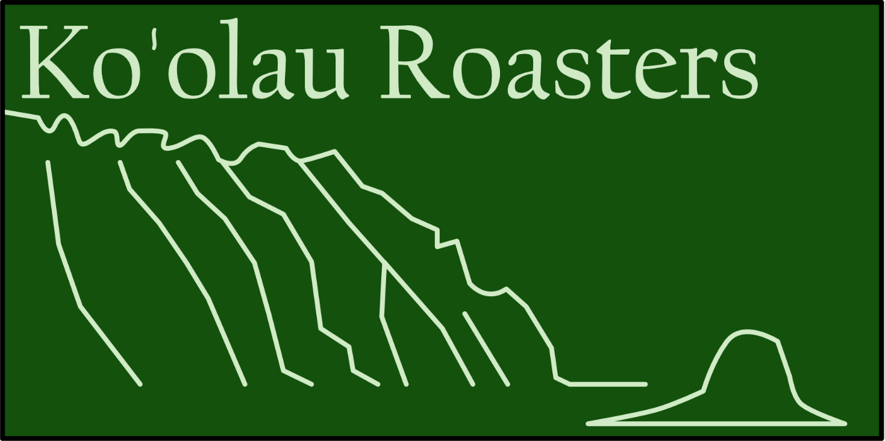

## Logo

{width="189"}

## Location

This is for this restaurant [space](https://www.loopnet.com/Listing/45-1151-Kamehameha-Hwy-Kaneohe-HI/39960141/) in Kaneohe, 21.418373774996557, -157.80145495447087

## Competition

Primary competition for this business is unfilled as what would be traditionally considered coffee shops in the area (roughly 5 miles) is solely Starbucks. Starbucks still proves to be tough competition for most coffee shops however if the brand fills a quality cafe style niche there will still be a sizeable market for most coffee shops. In the niche we are looking at the primary competitor is Tradition Coffee Roasters in Kapaa Quarry roughly 5 miles away and a 10 to 15 minute drive. Our major advantage over Tradition Coffee would be primarily an earlier opening time giving many the opportunity to get coffee BEFORE rush hour.

```{r, echo=FALSE}
library(sf) 
library(here) 
cafe_point <- st_read(here("data/cafes.gpkg")) 
```

```{r, echo=FALSE}

library(mapview) 
library(sf)  

mapviewOptions(basemaps = c("OpenStreetMap", "Esri.WorldImagery"))

sf_cafes <- st_as_sf(cafe_point) 
mapview(sf_cafes, label = sf_cafes$name)
```

Oahu has a lot of coffee shops, mostly congregated in the urban center of downtown Honolulu. Haleiwa, Kailua and Pearl City contain the large portion of what's left. On the map it looks like Kaneohe has options and competition however that's no quite the truth. Four of the locations are Starbucks, one is an on campus location for the community college, one is a restaurant and the last is a Boba Tea establishment. Yes at all of these locations you can get coffee but they don't cover the cafe coffee niche that places like Tradition Coffee Roasters or Morning Brew do.

## Resident Customer Demographics

```{r, echo=FALSE}
#| output: false

library(tidycensus) 
vars <- c(Population = "B01001_001",
          Commuters = "B08301_001",           
          Remote_Workers = "B08301_021",          
          Over_25 = "B15003_001")  

oahu_census <- get_acs(geography = "tract",                           
                       variables = vars,                           
                       state = "HI",                           
                       county = "Honolulu",                           
                       geometry = TRUE,                          
                       year = 2024)  
```

```{r, echo=FALSE}
establishment <- data.frame(    
  name = "My Shop",    
  lon = -157.80145495447087,   
  lat = 21.418373774996557) |>    
  st_as_sf(coords = c("lon", "lat"), crs = 4269)
```

```{r, echo=FALSE}
library(ggplot2) 
library(tidyverse)  
demograph <- oahu_census |>   
  filter(GEOID != c("15003981200","15003990001")) |>    
  ggplot() +   
  facet_wrap(~variable) +   
  geom_sf(aes(fill = estimate), color = "black") +   
  geom_sf(data = establishment, color = "red") +   
  coord_sf(xlim = c(-157.856390, -157.687223),             
           ylim = c(21.323029, 21.491402)) +   
  theme_minimal() +    
  scale_fill_viridis_c()
```

```{r, echo=FALSE}
demograph
```

Looking at the demographics of the area we can see that the Kaneohe and Ahuimanu area houses some 30-40 thousand people and a good proportion of them are over 25 year old commuters. Thanks to Oahu's large tourism industry our customer base wouldn't have to be completely local but it's good to have a reliable source of revenue nonetheless.

## Step 4.2 - Working Customer Demographics

```{r, echo=FALSE}

#| output: false


library(lehdr) 
library(dplyr) 
library(tigris)  
oahu_wrk <- grab_lodes(  
  state      = "hi",   
  year       = 2022,   
  lodes_type = "od",   
  job_type   = "JT00",   
  segment    = "S000",   
  state_part = "main",   
  agg_geo    = "tract" )  
commute_md <- compute_commute_stats(oahu_wrk, agg_geo = "tract")  

commute_md |>   dplyr::arrange(dplyr::desc(self_containment)) |>   
  dplyr::select(tract, workers_in, workers_out, net_flow, self_containment) |>   
  head(10)
```

```{r, echo=FALSE}
hi_tracts <- tracts(state="hi", year = 2022, cb = TRUE)  
map_hi <- hi_tracts |>    
  left_join(commute_md, by = c("GEOID" = "tract"))
```

```{r, echo=FALSE}
containment_graph <- map_hi |>    
  ggplot() +   
  geom_sf(aes(fill = self_containment), color = "black") +    
  theme_minimal() +   
  scale_fill_viridis_c(option= "plasma") +   
  geom_sf(data = establishment, color = "red")+   
  coord_sf(xlim = c(-157.856390, -157.687223),             
           ylim = c(21.323029, 21.491402)) 
```

```{r, echo=FALSE}
containment_graph
```

In terms of workers in the area we can see that most of them do not work in the same region in which they live however this becomes tricky in kaneohe with its small and numerous tracts.

## What's Nearby?

```{r, echo=FALSE}
library(mapboxapi) 
library(leaflet) 
library(mapview) 
library(basemaps) 
library(ggnewscale) 
library(leaflet.extras2)  

nearby6 <- mb_isochrone(
  location = "45-1151 Kamehameha Hwy",                        
  profile = "driving",                        
  time = 1:15,                         
  depart_at = "2025-01-09T06:00")  
nearby7 <- mb_isochrone(
  location = "45-1151 Kamehameha Hwy",                         
  profile = "driving",                         
  time = 1:15,                          
  depart_at = "2025-01-09T07:00") 
```

```{r, echo=FALSE}

 near_map_6 <- mapview(nearby6, alpha.regions = 0.21)
 near_map_7 <- mapview(nearby7, alpha.regions = 0.21)  
 
 near_map_6 | near_map_7
```

```{r, echo=FALSE}
poi <- data.frame(   
  name = c("Windward Mall", "Windward Community College", "He'eia Boat Harbor"),   
  lon = c(-157.805331,-157.81213270041525,-157.80983921011006),
  lat = c(21.420033, 21.40823562481841,21.44461685389027) ) |>
  st_as_sf(coords = c("lon", "lat"), crs = 4269)   
```

In the map above it is worth noting that Kailua which has many of this companies direct competitors falls well outside a 15 minute drive during rush hour.

Nearby we have Windward Mall, Windward Community College and He'eia Boat Harbor. Kaneohe is also a common place to travel through in getting to North Shore and Kualoa ranch meaning that there is some tourism presence in the area. In the same building Adela's Country Eatery a popular place to get lunch which means there will be a consistent flow of foot traffic during their operating hours.

```{r, echo=FALSE}
library(maptiles)
library(tidyterra) 
bg <- get_tiles(nearby7, provider = "Esri.WorldStreetMap", zoom = 12, crop = FALSE)

ggplot() +
  geom_spatraster_rgb(data = bg) +   
  geom_sf(data = nearby6, aes(fill = time), color = "black", alpha = 0.6) +   
  scale_fill_viridis_c(option = "plasma") +   
  geom_sf(data = establishment, color = "red", size = 2) +   
  geom_sf(data = poi, color = "white", size = 2)+   
  theme_minimal() +   
  coord_sf(xlim = c(-157.856390, -157.687223),            
           ylim = c(21.323029, 21.491402),            
           default_crs = sf::st_crs(4326))
```

## 

## Do we Need a Generator?

```{r, echo=FALSE}
#| output: FALSE  
library(arrow) 
library(here)  
eagle_i_hawaii <- read_feather(here("data/hawaii_outages_2025.feather"))  
```

```{r, echo=FALSE}
outages_over_time <- eagle_i_hawaii |>    
  filter(county == "Honolulu") |>    
  ggplot(aes(x = run_start_time, y = customers_out)) +   
  geom_line(linewidth = 0.2, color = "red") +   
  theme_minimal() +    
  labs(title = "Oahu customers without power 2025") +   
  xlab(" ") +    
  ylab("Customers Without Power") 
```

```{r, echo=FALSE}
outages_over_time
```

Since eagle I doesn't filter down to the tract level we can't determine from this data whether our business in particular would be effected by these outages. Looking at the data there were a couple significant spikes in January that could easily encompass the business but any more than three or four outages in 2025 would be wild guessing. A generator may still be wise though.

## Solar ?

```{r, echo=FALSE}
mapviewOptions(basemaps = c("OpenStreetMap", "Esri.WorldImagery"))  

solar_oahu <- st_read(here("data/oahu_solar_dedup_simple.geojson")) |>
  dplyr::select(geometry) 

solar_map <- mapview(solar_oahu,
                     popup = FALSE, label = FALSE, legend = FALSE)

solar_map@map |> setView(lng = -157.80145495447087, 
                         lat = 21.418373774996557,
                         zoom = 17) 
```

SAM3 Identified one set of solar panels on the roof of the building, however there doesn't appear to be enough to power 5 businesses simultaneously.
